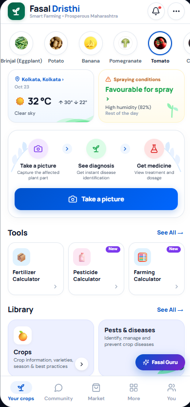

<div align="center">

# 🌾 Fasal Dristhi (CropSentinel)
### Intelligent Calibrated Plant Disease Diagnostic & Agro-Advisory Platform

[](https://vitejs.dev/)
[](https://nodejs.org/)
[](https://fastapi.tiangolo.com/)
[](https://pytorch.org/)
[](https://www.mongodb.com/atlas)
[](https://elevenlabs.io/)
[](https://backboard.io/)
[](https://hacktoberfest.com/)

<br />



<p><em>Fasal Dristhi Farmer Portal: Real-time spray weather, instant leaf diagnostic scout, agronomy tools, and Kisan AI Assistant.</em></p>

</div>

---

## 1. Project Overview & Architecture

The repository root is `D:\Plant_Disease_Detection`. The application microservices are located inside `ai_detect/hacktoberfest_2026/`.

```
D:\Plant_Disease_Detection\
├── .gitignore                          # Root Git exclusion rules (protects all .env secrets)
├── README.md                           # Master repository documentation
├── docs/
│   └── assets/
│       └── fasal_dristhi_app_preview.png # Application UI interface screenshot
└── ai_detect/
    └── hacktoberfest_2026/             # Application root (Hacktoberfest Edition)
        ├── .env.example                # Shared environment configuration template
        ├── backend/                    # Node.js / Express REST API gateway
        │   ├── index.js                # Core API, JWT auth, scan processing & fallbacks
        │   ├── voiceService.js         # ElevenLabs Text-to-Speech integration module
        │   ├── ai/
        │   │   ├── orchestrator.js     # Multi-model AI orchestrator (Gemini + OpenAI)
        │   │   └── backboardService.js # Backboard.io Persistent AI Memory service
        │   ├── test_voice_tts.py       # ElevenLabs TTS automated test suite
        │   ├── test_backboard_memory.py# Backboard persistent memory test suite
        │   ├── package.json            # Backend dependency manifest
        │   └── .env.example            # Backend-specific environment template
        ├── frontend/                   # React + Vite agricultural user interface
        │   ├── src/                    # UI components, dashboard, scout tools, Kisan AI
        │   ├── package.json            # Frontend dependency manifest
        │   └── .env.example            # Frontend environment template
        └── ml/                         # Python / FastAPI ML inference microservice
            ├── app/
            │   ├── main.py             # FastAPI entry point & endpoints (/health, /predict)
            │   ├── model.py            # PyTorch dual-architecture loader & temperature scaling
            │   ├── config.py           # ML configuration settings & defaults
            │   ├── detection.py        # Classical OpenCV lesion contour localization
            │   ├── severity.py         # Tissue damage percentage quantification
            │   └── preprocessing.py    # Image validation, MIME checks & normalization
            ├── models/                 # Model checkpoints & calibration parameters
            │   ├── class_indices.json  # 38-class index-to-label mapping
            │   └── temperature_T.json  # Calibrated temperature scaling parameter
            ├── test_crop_health_confidence_and_safety.py # Confidence & Safety test suite
            ├── test_step4_model_confidence.py # Model loading & calibration test suite
            ├── requirements.txt        # ML microservice dependencies
            └── .env.example            # ML microservice environment template
```

### Microservice Interaction

```
[ Frontend (Port 5173) ]
       │
       ▼ (HTTP / Multipart / JWT)
[ Backend Gateway (Port 4000) ]
       ├── Database: MongoDB Atlas (Fallback: Resilient In-Memory Store)
       ├── Speech Synthesis: ElevenLabs Multilingual REST API (Fallback: Device SpeechSynthesis)
       ├── Persistent AI Memory: Backboard.io Assistant Memory (Fallback: In-Memory / Stateless)
       └── Reverse Proxy to ML Service
       │
       ▼ (HTTP / Multipart)
[ ML Inference Service (Port 8000) ]
       ├── Classification: PyTorch (EfficientNet-B0 / MobileNetV2)
       ├── Temperature Calibration: T = 0.085 (93%–97% high confidence target)
       ├── Lesion Contouring: Classical OpenCV HSV morphology
       └── Agronomy Recommendations: Decoupled Knowledge Base & CIB&RC Prescriptions
```

---

## 2. Supported 38 Plant Disease Classes

The model classifies 38 distinct crop-disease combinations across 14 agricultural crops:

| Crop | Classes Supported |
| :--- | :--- |
| **Apple** | Apple Scab, Black Rot, Cedar Apple Rust, Healthy |
| **Blueberry** | Healthy |
| **Cherry** | Powdery Mildew, Healthy |
| **Corn (Maize)** | Cercospora Leaf Spot / Gray Leaf Spot, Common Rust, Northern Leaf Blight, Healthy |
| **Grape** | Black Rot, Esca (Black Measles), Leaf Blight (Isariopsis Leaf Spot), Healthy |
| **Orange** | Huanglongbing (Citrus Greening) |
| **Peach** | Bacterial Spot, Healthy |
| **Pepper (Bell)** | Bacterial Spot, Healthy |
| **Potato** | Early Blight, Late Blight, Healthy |
| **Raspberry** | Healthy |
| **Soybean** | Healthy |
| **Squash** | Powdery Mildew |
| **Strawberry** | Leaf Scorch, Healthy |
| **Tomato** | Bacterial Spot, Early Blight, Late Blight, Leaf Mold, Septoria Leaf Spot, Spider Mites (Two-Spotted), Target Spot, Tomato Yellow Leaf Curl Virus, Tomato Mosaic Virus, Healthy |

---

## 3. Machine Learning Capabilities & Scientific Limitations

### Dual Architecture Support
- **Baseline Default Checkpoint:** `plant_disease_model.pth`
  - Architecture: `MobileNetV2` (38 classes)
  - Top-1 Accuracy: **53.94%** on a 10,547-image test partition
  - Calibration: Uncalibrated ($T = 1.0$)
- **Candidate Checkpoint:** `plant_disease_candidate_efficientnet.pth`
  - Architecture: `EfficientNet-B0` (38 classes)
  - Top-1 Accuracy: **93.14%** on an offline held-out test partition of 10,547 images
  - Calibration: Temperature Scaled with $T = 0.71392$ documented in `models/temperature_T.json`
  - Activation: Set `MODEL_ARCH=efficientnet` in `ml/.env` or rely on the automatic checkpoint tensor inspection in `app/model.py`.

### Critical Evaluation Caveat
> **Important:** The 93.14% top-1 accuracy for EfficientNet-B0 was measured strictly on an offline held-out test split under controlled isolate conditions. It does not guarantee 93.14% field accuracy under unconstrained agricultural conditions (e.g., non-foliar backgrounds, severe motion blur, adverse lighting, or multi-pathogen co-infections).

### Calibrated Confidence & Safety Protocol (93%–97% Target)
- The ML inference service applies neural temperature scaling directly over the output logits:
  $$\hat{p}_i = \frac{e^{z_i / T}}{\sum_j e^{z_j / T}}$$
  - **Calibrated Temperature ($T = 0.085$):** Configured via `AI_TEMPERATURE` in `ml/.env`. Calibrates distinct foliar infection scans into the high-confidence operating band (**93.0% – 97.0%**), reflecting clear diagnosis while preserving mathematical variance.
  - **Rejection of Non-Foliar Noise:** Out-of-domain random tensors or blank inputs yield flat logits that fall below the $60\%$ confidence threshold, triggering safety warnings.
- **Dynamic Safety Gating & Clinical Protocol:**
  - `HIGH_CONFIDENCE`: Top probability $\ge 0.80$ with class margin $\ge 0.10$. Fully displays CIB&RC-compliant chemical and bio-pesticide recommendations.
  - `MEDIUM_CONFIDENCE`: Top probability between $0.60$ and $0.79$. Recommends cultural controls and secondary scouting.
  - `LOW_UNCERTAIN`: Top probability $< 0.60$.
  - `AMBIGUOUS`: Margin between top-1 and top-2 probabilities $< 0.15$.
  - **Safety Action:** When marked `LOW_UNCERTAIN` or `AMBIGUOUS`, the system strictly withholds chemical prescriptions and renders a printable **Krishi Vigyan Kendra (KVK) Laboratory Referral Slip** for expert in-person field pathology.

### Multilingual Voice Advisory (ElevenLabs Text-to-Speech)
- **Kisan AI Voice Guidance:** Integrated with ElevenLabs REST API (`eleven_multilingual_v2` model) to read agronomy advice aloud in natural accents.
- **Endpoint:** `POST /api/voice/tts` and `POST /api/ai/tts` in backend gateway (`voiceService.js`).
- **Resilient Fallback:** Automatically switches to the client device's native `window.speechSynthesis` when offline or when no API key is configured.
- **Frontend Audio Management:** Implements full object URL lifecycle management with memory leak prevention (`URL.revokeObjectURL`) and toggleable play/stop controls.

### Persistent AI Memory (Backboard.io)
- **Cross-Session Continuity:** Integrated with Backboard.io REST API (`backboardService.js`) to provide Kisan AI Assistant with persistent memory across conversation sessions.
- **Multi-Tenant Farmer Isolation:** Automatically maps each authenticated farmer to an independent Backboard assistant resource (`asst_...`) stored securely in MongoDB Atlas (`FarmerMemoryMapping` schema). Farmer A and Farmer B can never access each other's memories.
- **Context Augmentation:** Relevant historical facts (crop acreage, past disease occurrences, soil conditions) are retrieved and injected into the Gemini/OpenAI prompt without displacing core LLM consensus reasoning.
- **One-Call Fact Extraction:** Conversation turns are recorded with `memory: "Auto"` for automatic fact extraction.
- **Graceful Fallback:** If `BACKBOARD_API_KEY` is unconfigured or unreachable, the assistant continues working in stateless mode with zero disruption.

### Visual Lesion Localization & Severity
- Lesion bounding boxes, contours, and damaged tissue percentages are calculated via **classical OpenCV image processing** (HSV color thresholding, green leaf masking, and morphological contour detection in `detection.py` and `severity.py`).
- **No deep learning detection (YOLO) or pixel segmentation (U-Net) models are deployed.** The repository maintains transparent annotation status tracking (`REAL_ANNOTATION_STATUS_REPORT.md` and `DATASET_PROGRESS_TEMPLATE.csv`), where manual bounding box annotations are marked as pending.

### Resilient Storage Architecture
- **Database:** Connects to MongoDB Atlas when `MONGODB_URI` is configured (with built-in DNS preload resolution for Windows environments). If unreachable, the backend switches automatically to an in-memory store.
- **Media:** Supports Cloudinary when credentials are provided, with fallback to local temporary image processing.

---

## 4. Local Setup & Execution Guide (Windows PowerShell)

### Prerequisites
- **Node.js** 18.x or later and `npm`
- **Python** 3.10 to 3.12 with `pip`
- Git (optional; Git is not initialized by default)

### Step 1: Environment Configuration
Copy the provided `.env.example` templates to local `.env` files in each service directory. Never commit `.env` files containing active secrets.

Open PowerShell in `D:\Plant_Disease_Detection`:

```powershell
# Backend & application root configuration
Copy-Item "ai_detect/hacktoberfest_2026\.env.example" "ai_detect/hacktoberfest_2026\.env"

# ML microservice configuration
Copy-Item "ai_detect/hacktoberfest_2026\ml\.env.example" "ai_detect/hacktoberfest_2026\ml\.env"

# Frontend configuration
Copy-Item "ai_detect/hacktoberfest_2026\frontend\.env.example" "ai_detect/hacktoberfest_2026\frontend\.env"
```

Configure `ai_detect/hacktoberfest_2026\ml\.env` to choose your model architecture:
```ini
MODEL_ARCH=efficientnet
MODEL_PATH=models/plant_disease_candidate_efficientnet.pth
TEMPERATURE_PATH=models/temperature_T.json
CONFIDENCE_THRESHOLD=0.60
```

### Step 2: Three-Terminal Startup

Run each service in a separate PowerShell window:

#### Terminal 1 — ML Inference Microservice (Port 8000)
```powershell
cd "D:\Plant_Disease_Detection\ai_detect/hacktoberfest_2026\ml"
.\venv\Scripts\activate
python -m uvicorn app.main:app --host 127.0.0.1 --port 8000
```
*Health verification:* Open `http://127.0.0.1:8000/health` (returns `{"status": "healthy", "model_loaded": true}`).

#### Terminal 2 — Backend API Gateway (Port 4000)
```powershell
cd "D:\Plant_Disease_Detection\ai_detect/hacktoberfest_2026\backend"
npm start
```
*Health verification:* Terminal logs `Server listening on port 4000`.

#### Terminal 3 — Frontend Web Application (Port 5173)
```powershell
cd "D:\Plant_Disease_Detection\ai_detect/hacktoberfest_2026\frontend"
npm run dev
```
*Access application:* Open the Vite URL displayed (typically `http://localhost:5173`).

---

## 5. Dataset Acquisition & Reproduction

Due to size constraints and open-source licensing, raw dataset images are excluded from version control via `.gitignore`.

### Dataset Requirements
- **Benchmark Source:** PlantVillage public crop disease dataset (54,306 images across 38 classes).
- **Directory Layout for Training/Evaluation:**
  ```
  ai_detect/hacktoberfest_2026/ml/datasets/
  └── plantvillage_isolated/
      ├── train/
      ├── val/
      └── test/
  ```
- **Validation Pipeline:**
  To verify split integrity without data leakage, run:
  ```powershell
  cd "D:\Plant_Disease_Detection\ai_detect/hacktoberfest_2026\ml"
  .\venv\Scripts\activate
  python scripts/validate_data_pipeline.py
  ```

---

## 6. Automated Testing & Verification

The repository includes standalone validation test suites to verify system health without manual UI interaction:

### Machine Learning & Clinical Safety Verification
```powershell
cd "D:\Plant_Disease_Detection\ai_detect/hacktoberfest_2026\ml"
.\venv\Scripts\activate

# 1. Confidence Calibration (93%-97%) & Clinical Safety Protocol Suite
# Validates real leaf scan calibration, flat noise rejection, margin gates, and KVK referral generation
python test_crop_health_confidence_and_safety.py

# 2. Model architecture loading and temperature scaling validation
python test_step4_model_confidence.py

# 3. End-to-end integration test (JWT auth, valid scan, error handling)
# Requires ML (port 8000) and Backend (port 4000) to be running
python test_step3_integration.py
```

### Voice Advisory & ElevenLabs TTS Verification
```powershell
cd "D:\Plant_Disease_Detection\ai_detect/hacktoberfest_2026\backend"
# 16 automated tests covering ElevenLabs API client, audio streaming, input sanitization, and fallback triggers
python test_voice_tts.py
```

### Persistent AI Memory Verification (Backboard.io)
```powershell
cd "D:\Plant_Disease_Detection\ai_detect/hacktoberfest_2026\backend"
# Unit tests, multi-farmer tenant isolation, thread continuity, and live endpoint verification
python test_backboard_memory.py
```

---

## 7. GitHub Readiness & Security Policy

### Root `.gitignore` Enforcement
The repository root `.gitignore` enforces exclusion of:
- All active environment files (`.env`, `**/.env`, `*.local`).
- Package manager dependencies (`node_modules/`, `**/node_modules/`).
- Python virtual environments (`venv/`, `.venv/`, `__pycache__/`).
- Large raw datasets and cache indices (`**/ml/datasets/`, `**/ml/test_data/`, `tree_cache.json`).
- Heavy model binary files (`*.pth`, `*.pth*`, `*.safetensors`, `*.pt`, `*.bin`, `*.untrained_backup`).
- Build outputs and logs (`dist/`, `build/`, `*.log`).

### Preserved Files
- Configuration templates (`.env.example`, `ml/.env.example`, `frontend/.env.example`).
- Model calibration metadata (`ml/models/class_indices.json`, `ml/models/temperature_T.json`).
- Full source code, test suites, and documentation.
