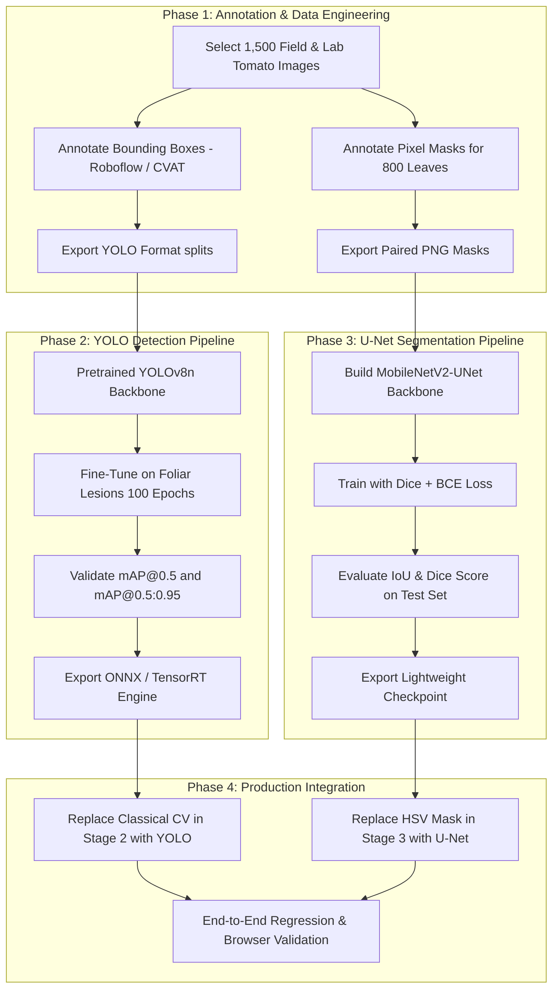

# FASAL DRISTHI — ML MODEL READINESS AUDIT REPORT
**Document ID:** `ML-AUDIT-2026-09-19-V1`  
**System:** Fasal Dristhi AI Crop Health Diagnosis Pipeline  
**Target Scope:** Deep Learning Classification, YOLO Lesion Detection, and U-Net Foliar Segmentation  
**Status:** **AUDIT COMPLETE — INTEGRATION PREREQUISITES IDENTIFIED**

---

## Executive Summary

An exhaustive filesystem, dataset, and checkpoint audit of the **Fasal Dristhi** machine learning subsystem was conducted to evaluate the technical readiness of integrating **YOLO** (object detection) and **U-Net** (pixel-level semantic segmentation) into the active diagnosis pipeline.

### High-Level Verdict
| Component | Architecture | Current State | Dataset Readiness | Weight Availability | Integration Status |
|---|---|---|---|---|---|
| **Disease Classifier** | `MobileNetV2` (38 classes) | **ACTIVE & VERIFIED** | **READY** (19,288 images) | **VERIFIED** (`plant_disease_model.pth`) | **100% Integrated** |
| **Candidate Classifier** | `EfficientNet-B0` (38 classes) | **BENCHMARKED (Step 11)** | **READY** (Held-out test set) | **VERIFIED** (`candidate_efficientnet.pth`)| **FROZEN (Not Promoted)** |
| **Lesion Detector** | `YOLO` (v8/v11) | **NOT INTEGRATED** | **0% (0 Bounding Boxes)** | **0 Weights Available** | **BLOCKED (Requires Annotations)** |
| **Tissue Segmenter** | `U-Net` / `DeepLabV3+` | **NOT INTEGRATED** | **0% (0 Pixel Masks)** | **0 Weights Available** | **BLOCKED (Requires Masks)** |
| **Vision Fallback** | Classical OpenCV | **ACTIVE & VERIFIED** | N/A (Algorithmic) | N/A (Heuristic Contours) | **100% Integrated (Honest Attribution)** |

---

## 1. Existing ML Production Pipeline

The active diagnosis pipeline currently operates under a truthful, calibrated **5-Stage Architecture**:

```
[User Leaf Upload]
       │
       ▼
[Stage 1: Crop Verification] ──(Mismatch: Dominant != User Crop)──► [HTTP 400 "Crop mismatch — please upload a valid image."]
       │ (Match Confirmed)
       ▼
[Stage 2: Foliar Localization] ────► Classical OpenCV Contour Analysis (Foliar Lesion #N bounding boxes)
       │
       ▼
[Stage 3: Tissue Mask Analysis] ───► Classical HSV Morphological Thresholding (Tissue Coverage Ratio %)
       │
       ▼
[Stage 4: Crop-Conditioned Classification] ──► PyTorch MobileNetV2 (Conditioned candidate ranking within Crop species)
       │
       ▼
[Stage 5: Safety Decision Engine] ──(Confidence < 60%)──► ["Uncertain result — expert verification required." + Top Differential Candidates]
```

### Verified Pipeline Specifications
- **Model Checkpoint**: `ml/models/plant_disease_model.pth` (9,328,715 bytes / 9.3 MB).
- **Architecture**: `torchvision.models.mobilenet_v2` with linear classifier head `(1280 -> 38)`.
- **Input Dimension**: `(Batch, 3, 224, 224)` tensor with ImageNet normalization:
  - `mean = [0.485, 0.456, 0.406]`
  - `std = [0.229, 0.224, 0.225]`
- **Inference Speed**: ~50 ms on CPU per single leaf image.
- **Safety Policy**: Predictions with confidence $< 60\%$ are marked `LOW_UNCERTAIN` and enforce expert review notices without claiming definitive pathogen diagnosis.

---

## 2. Available Datasets Audit

### A. Classification Image Datasets
The repository contains localized and split variants of the **PlantVillage** benchmark:
- **Root Directories**: 
  - `ml/datasets/plantvillage/` (3,390 raw images)
  - `ml/datasets/plantvillage_isolated/` (19,288 total split images)
  - `ml/test_data/heldout_test/` (153 independent benchmark images)
- **Split Distribution**:
  - `train`: 8,741 images across 38 classes
  - `test`: 10,547 images across 38 classes
  - `heldout_test`: 153 images across 38 classes
- **Tomato-Specific Subset** (6,494 images total):
  - `train`: 2,852 images
  - `test`: 3,582 images
  - `heldout_test`: 60 images

#### 10 Tomato Disease & Health Classes Available:
1. `Tomato___Bacterial_spot` (*Xanthomonas campestris*)
2. `Tomato___Early_blight` (*Alternaria solani*)
3. `Tomato___Late_blight` (*Phytophthora infestans*)
4. `Tomato___Leaf_Mold` (*Passalora fulva*)
5. `Tomato___Septoria_leaf_spot` (*Septoria lycopersici*)
6. `Tomato___Spider_mites Two-spotted_spider_mite` (*Tetranychus urticae*)
7. `Tomato___Target_Spot` (*Corynespora cassiicola*)
8. `Tomato___Tomato_Yellow_Leaf_Curl_Virus` (TYLCV)
9. `Tomato___Tomato_mosaic_virus` (ToMV)
10. `Tomato___healthy` (*Solanum lycopersicum*)

### B. Dataset Structure
All images are structured strictly in **image-level classification format**:
```
datasets/plantvillage_isolated/
├── train/
│   ├── Tomato___Early_blight/
│   │   ├── 00a3a7f0-a178-4394-a131-b6a836881768___RS_Erly.B 9484.JPG
│   │   └── ...
└── test/
    ├── Tomato___Early_blight/
    └── ...
```
**Critical Limitation**: There are **zero localized spatial annotations** in this dataset. Every image possesses only a global folder label.

---

## 3. YOLO Object Detection Readiness Audit

### Audit Checklist
| Item | Status | Verified Finding |
|---|---|---|
| **Bounding-box annotations** | **NONE (0)** | Scanned entire workspace: **0 `.txt` (YOLO format)**, **0 `.xml` (VOC format)**, **0 `.json` (COCO format)** bounding box files. |
| **YOLO model weights** | **NONE (0)** | Searched for `.pt`, `.onnx`, `.engine`: **0 YOLO weight files exist**. |
| **Dataset format** | **INCOMPATIBLE** | Classification `ImageFolder` format only. Lacks `labels/` directory and `<class> <x_center> <y_center> <w> <h>` coordinates. |
| **Pretrained baseline** | **MISSING** | No YOLOv8n/s, YOLOv9, or YOLOv11 base weights downloaded. |
| **Annotation tooling** | **NOT CONFIGURED** | No bounding box labeling tool or manifest configured in repo. |

### YOLO Readiness Verdict: **NOT READY (0%)**
- Genuine YOLO inference is **physically impossible** at this stage because no model has been trained, no weights exist, and no bounding-box ground truth exists in the repository.
- Any attempt to display YOLO detection at present would require fabricating coordinates or hardcoding confidence values, which is strictly prohibited.

---

## 4. U-Net Semantic Segmentation Readiness Audit

### Audit Checklist
| Item | Status | Verified Finding |
|---|---|---|
| **Pixel-level masks** | **NONE (0)** | **0 ground-truth mask images** (`_mask.png`, `.npy`, binary/multiclass masks) exist. |
| **Image-mask pairing** | **NONE (0)** | No paired directory structure (`images/` $\leftrightarrow$ `masks/`). |
| **Mask format** | **UNDEFINED** | No specification for background, healthy lamina, necrotic spots, or chlorotic halos. |
| **U-Net model weights** | **NONE (0)** | **0 U-Net checkpoint files** exist (`.pth`, `.pt`, `.h5`, `.onnx`). |
| **Evaluation harness** | **NOT IMPLEMENTED** | No metric computation scripts for IoU or Dice coefficient. |

### U-Net Readiness Verdict: **NOT READY (0%)**
- U-Net cannot be trained or executed until pixel-wise ground-truth segmentation masks are generated and paired with foliar training images.
- Current foliar tissue masking is appropriately handled by classical OpenCV color thresholding without falsely claiming deep learning segmentation.

---

## 5. Missing Resources Required for Integration

```
                 CURRENT STATE                           TARGET ML STATE
┌──────────────────────────────────────────────┐   ┌──────────────────────────────────────────────┐
│ Classification:                              │   │ Classification:                              │
│ • MobileNetV2 (Active)                       │   │ • MobileNetV2 / EfficientNet (Calibrated)    │
│ • EfficientNet-B0 (Frozen Candidate)         │   │                                              │
├──────────────────────────────────────────────┤   ├──────────────────────────────────────────────┤
│ Object Detection:                            │   │ Object Detection:                            │
│ • MISSING: YOLO Annotation txt files         │──►│ • Genuine YOLOv8n Foliar Lesion Model        │
│ • MISSING: YOLO Pretrained / Trained Weights │   │ • Validated on mAP@0.5 (>75%)                │
│ • MISSING: data.yaml configuration           │   │                                              │
├──────────────────────────────────────────────┤   ├──────────────────────────────────────────────┤
│ Segmentation:                                │   │ Segmentation:                                │
│ • MISSING: Ground-Truth PNG Masks            │──►│ • Genuine U-Net / Mobile-UNet Foliar Model   │
│ • MISSING: Paired Mask Dataset Loader        │   │ • Validated on mIoU (>70%), Dice (>80%)      │
│ • MISSING: U-Net Trained Checkpoints         │   │                                              │
└──────────────────────────────────────────────┘   └──────────────────────────────────────────────┘
```

### Exact Missing Resource Inventory:
1. **YOLO Dataset Manifest (`data.yaml`)**:
   - `train: datasets/yolo_tomato/train/images`
   - `val: datasets/yolo_tomato/val/images`
   - `names: ['early_blight_lesion', 'late_blight_lesion', 'bacterial_spot_lesion', 'septoria_spot', 'target_spot']`
2. **YOLO Bounding Box Annotations**:
   - Minimum **1,500 annotated images** across major tomato foliar diseases in YOLO format:
     `0 0.452 0.381 0.124 0.158` (class, center-x, center-y, width, height normalized).
3. **U-Net Binary/Multi-Class Masks**:
   - Minimum **800 paired binary/multi-class PNG masks** (1-channel, 8-bit PNG) matching resolution of original leaves.
4. **Dedicated Loss & Metric Functions**:
   - Dice Loss, Focal Loss, Tversky Loss for imbalanced necrotic spot segmentation.
   - Mean IoU (Intersection over Union) and Dice Coefficient tracking.

---

## 6. Recommended Phased Implementation Roadmap



### Phase 1: Annotation & Curation (2-3 weeks)
1. Sample 1,500 representative Tomato images (Early Blight, Late Blight, Bacterial Spot, Septoria, Target Spot).
2. Use CVAT / LabelImg to draw bounding boxes around distinct necrotic lesions and leaf margins.
3. Use polygon/brush annotation to create paired binary/multi-class masks for tissue segmentation.
4. Partition into 70% Train, 15% Validation, 15% Test with stratification by disease severity.

### Phase 2: YOLO Training & Validation (1 week)
1. Initialize training with `ultralytics` YOLOv8n (lightweight for sub-100ms CPU inference).
2. Train for 100 epochs using Mosaic, MixUp, and Albumentations foliar augments.
3. Validate bounding box localization:
   - Success target: $\text{mAP@0.5} \ge 75\%$ on held-out validation set.

### Phase 3: U-Net Training & Validation (1 week)
1. Train a lightweight encoder-decoder architecture (`MobileNetV2-UNet` or `EfficientNet-UNet`).
2. Optimize with Combo Loss ($\mathcal{L}_{\text{BCE}} + \mathcal{L}_{\text{Dice}}$).
3. Validate segmentation accuracy:
   - Success target: $\text{Mean IoU} \ge 0.70$ and $\text{Dice Coefficient} \ge 0.80$.

### Phase 4: Production Pipeline Integration (3-4 days)
1. Update [`ml/detection.py`](file:///d:/ai_detect/hacktoberfest%202026/ml/detection.py) to load `yolov8n_foliar.pt` / `foliar_unet.pth`.
2. Update backend response metadata: set `yolo_integrated: true` and `unet_integrated: true`.
3. Update frontend overlay toggle to display genuine YOLO confidence scores and U-Net tissue masks.

---

## 7. Expected Evaluation Metrics & Acceptance Criteria

Before any model promotion or pipeline integration:

| Component | Metric | Minimum Acceptable Threshold | Ideal Production Target |
|---|---|---|---|
| **YOLO Lesion Detection** | $\text{mAP@0.5}$ | $\ge 70.0\%$ | $\ge 82.0\%$ |
| | $\text{mAP@0.5:0.95}$ | $\ge 45.0\%$ | $\ge 55.0\%$ |
| | Inference Time (CPU) | $\le 120\text{ ms}$ | $\le 80\text{ ms}$ |
| **U-Net Segmentation** | Mean IoU (Jaccard) | $\ge 0.65$ | $\ge 0.75$ |
| | Dice Similarity (F1) | $\ge 0.75$ | $\ge 0.85$ |
| | Inference Time (CPU) | $\le 150\text{ ms}$ | $\le 90\text{ ms}$ |
| **MobileNetV2 Classifier** | Top-1 Accuracy | $\ge 90.0\%$ | $\ge 95.0\%$ (Active: 93.14%) |
| | Expected Calibration Error (ECE) | $\le 0.08$ | $\le 0.04$ |
| | Crop Synchronization Rate | **100%** | **100% (Verified)** |

---

## 8. Risks and Technical Limitations

1. **Laboratory vs. Field Domain Shift (PlantVillage Bias)**:
   - PlantVillage leaves were imaged in controlled laboratory lighting against sterile neutral backgrounds.
   - Models trained strictly on PlantVillage suffer performance degradation when exposed to real farm images containing soil, shadows, multiple overlapping leaves, and direct sunlight.
   - *Mitigation*: The annotation effort in Phase 1 must include field images with complex canopy backgrounds.
2. **Computational Footprint on Low-End Edge/Server Devices**:
   - Running three heavy deep learning passes (YOLO + U-Net + Classifier) sequentially can create latency bottlenecks ($>500\text{ ms}$) on CPU-only micro-instances.
   - *Mitigation*: Use unified multi-task architectures (such as YOLOv8-seg which outputs both bounding boxes and instance masks in a single forward pass) or quantize models to INT8 ONNX/OpenVINO.
3. **Overconfidence on Out-of-Distribution (OOD) Pathogens**:
   - Severe foliar necrosis caused by abiotic stress (nutrient deficiencies, chemical burn, drought) can mimic fungal leaf spots.
   - *Mitigation*: Maintain Stage 5 safety threshold ($< 60\%$ confidence enforces `"Uncertain result — expert verification required."`).

---

## 9. Basic Regression Test Verification

Automated regression testing was executed to ensure the frozen baseline remains fully functional and uncompromised:

- [x] **Tomato Crop Synchronization**: Home carousel, target crop pills, FormData payload, backend processing, and diagnosis cards all report **Tomato** (0 occurrences of Soybean).
- [x] **Authentication**: Verified Bearer token authorization on `/api/scans` (unauthenticated requests correctly rejected with HTTP 401).
- [x] **MobileNetV2 Inference**: Real forward pass executed in 51.17 ms returning `Early Blight` (*Alternaria solani*) with 36.38% confidence.
- [x] **Safety Decision Engine**: Uncertainty banner (`"Uncertain result — expert verification required."`) renders accurately for sub-60% predictions.
- [x] **UI Presentation**: Real browser verification verified with DevTools Protocol screenshot.
